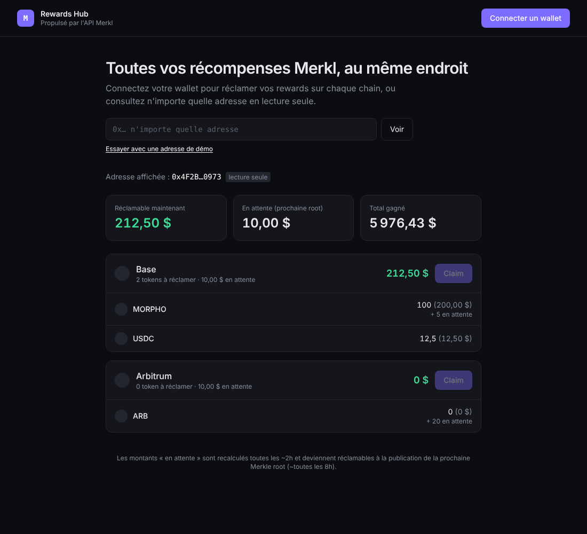

# Rewards Hub · Merkl

Un mini « Rewards Hub » qui centralise les récompenses [Merkl](https://merkl.xyz) d'une adresse sur toutes les chains, et permet de les **claim onchain** en un clic par chain.

Construit en une journée pour comprendre de l'intérieur le produit Merkl : API v4, Merkle proofs et contrat `Distributor`.



## Fonctionnalités

- **Vue multi-chain** : montants réclamables, en attente et déjà perçus, convertis en USD, avec les chains triées par montant réclamable.
- **Lecture seule** : on peut consulter n'importe quelle adresse sans connecter de wallet.
- **Claim onchain** : un claim groupé par chain via `Distributor.claim()`, avec bascule automatique de réseau, suivi de la transaction et lien vers l'explorer.
- **Synchronisation post-claim** : `reloadChainId` force l'API à relire l'état onchain sans attendre les ~5 min d'indexation.
- **Gestion d'erreurs lisible** : signature refusée, preuve périmée (nouvelle root publiée), revert.

## Stack

React 19 · TypeScript (strict) · Vite · TailwindCSS v4 · wagmi v3 / viem · TanStack Query · Vitest

## Lancer le projet

```bash
npm install
npm run dev      # http://localhost:5173
npm test         # tests unitaires de la logique métier
npm run build    # typecheck + build de prod
```

Aucune clé d'API n'est nécessaire : l'API Merkl accepte les appels anonymes, jusqu'à 10 requêtes par seconde.

## Comment ça marche

```
Merkl API  ──GET /v4/users/{addr}/rewards/summary──▶  amount, claimed, pending, proofs (par token, par chain)
                                                       │
                       claimable = amount - claimed ◀──┘
                                                       │
Wallet  ──Distributor.claim(users, tokens, amounts, proofs)──▶  le contrat recalcule la Merkle root
                                                                 à partir de la preuve et paie la différence
```

Le code est organisé ainsi :
- `src/lib/merkl.ts` contient les types de l'API et la logique métier pure, testée unitairement.
- `src/lib/distributor.ts` contient l'adresse et l'ABI minimale du contrat.
- `src/hooks/useClaim.ts` gère le flow de claim : switch chain, signature, confirmation, resync.

## Les subtilités qui comptent

1. **Les montants sont cumulatifs.** `amount` est le total crédité depuis toujours, déjà-claimé inclus. On passe donc `amount` tel quel au contrat, et pas `amount - claimed`. Le contrat mémorise ce qu'il a déjà versé et ne paie que la différence. Le test `buildClaimArgs` verrouille ce comportement.
2. **`pending` n'est pas réclamable.** Ces montants sont calculés environ toutes les 2h mais ne figurent pas encore dans une root publiée. L'app les affiche à part et ne les additionne jamais au réclamable.
3. **Les décimales varient d'un token à l'autre.** USDC en a 6, la plupart des tokens en ont 18. Tous les calculs se font en `bigint`, et on ne convertit qu'au moment de l'affichage.
4. **Une preuve peut expirer.** Si une nouvelle root est publiée entre le chargement de la page et la signature, le contrat revert avec `InvalidProof`. L'app l'explique à l'utilisateur.

## Pistes d'amélioration

- **Historique** : afficher les claims passés via `GET /v4/claims`.
- **Breakdowns** : détailler d'où vient chaque récompense, campagne par campagne, avec `/rewards/breakdowns`.
- **Opportunités actives** : utiliser `/rewards/active-opportunities` pour suggérer où déposer pour gagner plus.
- **Claim multi-chain en un geste** : avec les smart accounts (EIP-5792), on pourrait regrouper les claims de plusieurs chains.
- **Notifications** quand le réclamable dépasse un seuil.

---

Sources : [Merkl Developer Portal](https://developers.merkl.xyz/integrate-merkl/user-rewards) · [Chains & Contracts](https://developers.merkl.xyz/resources/chains-and-contracts)
